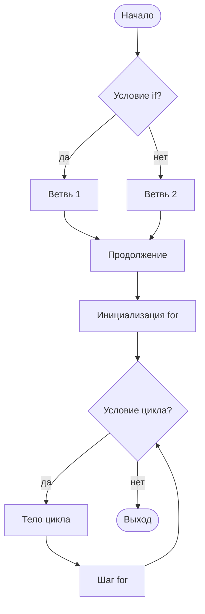

# Билет 19 — Управляющие конструкции C

[[00 — Карта билетов|← К билетам]] · [[Лекция 06 — Язык программирования (на примере C)|Лекция 06]]

> [!note] Формулировка экзамена (2025–2026)
> (Язык C) Основные конструкции управления вычислениями. Понятие цикла с пред- и с постусловием. Цикл for, операторы goto и switch. **Графическое изображение (блок-схема, граф потока управления основных конструкций).**

> [!danger] Строго обязательно: незнание выделенного в исходном списке подпункта ведёт к F
> **Графическое изображение (блок-схема, граф потока управления основных конструкций).**

## Порядок выполнения

Управляющие конструкции задают, какой оператор выполняется следующим:

| Конструкция | Действие |
|---|---|
| Последовательность | Выполнить операторы по порядку. |
| `if / else` | Выбрать ветвь по условию. |
| `while` | Цикл с предусловием: сначала проверить условие; тело может не выполниться ни разу. |
| `do ... while` | Цикл с постусловием: сначала выполнить тело, затем проверить условие; тело выполнится хотя бы один раз. |
| `for` | Цикл с предусловием и выражениями инициализации, условия и шага; части могут быть пустыми, поэтому `for (;;)` не завершается сам. Это не обязательно цикл со счётчиком. |
| `switch / case` | Перейти к метке, соответствующей целочисленному выражению; без `break` возможно продолжение в следующую ветвь (*fall-through* — проваливание). |
| `goto` | Безусловный переход к метке внутри той же функции. |

`goto` не запрещён языком: например, его применяют для перехода к общей точке освобождения ресурсов после ошибки. Произвольные переходы затрудняют чтение потока управления. Исторический контрпример к идее «всегда избегать необычных конструкций» — *Duff's device*, совмещающий `switch` и `do ... while` для развёртки цикла; это узнаваемый специальный приём, а не обычный стиль.

## Графическое представление

Блок-схема показывает шаги и развилки, а граф потока управления — возможные переходы между операторами. Ветвление `if` сходится после выбора одной из двух ветвей; в цикле обратная дуга возвращает к проверке условия:

Схема показывает `if` и `for`; различие циклов с предусловием и постусловием и переходы `switch` показаны отдельно:

![[lecture-06-control-flow.svg]]
