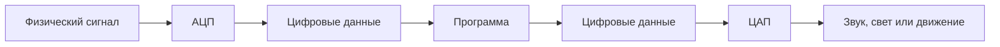
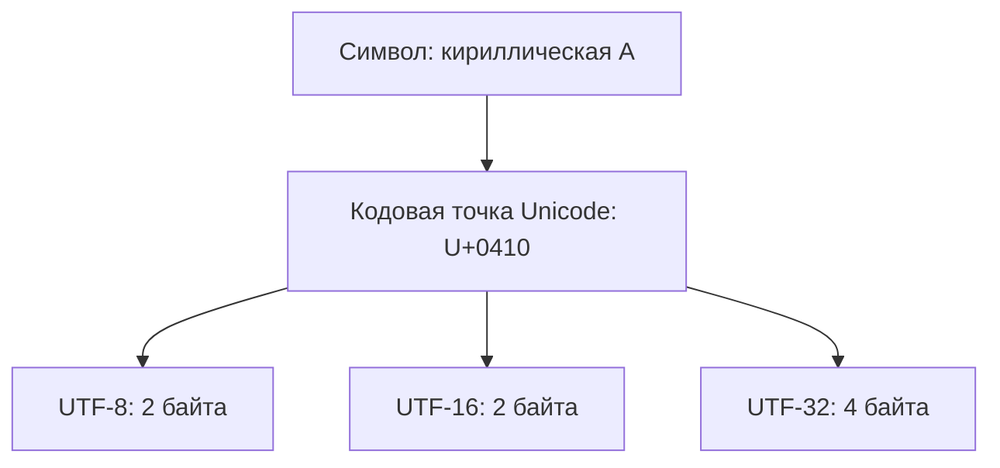
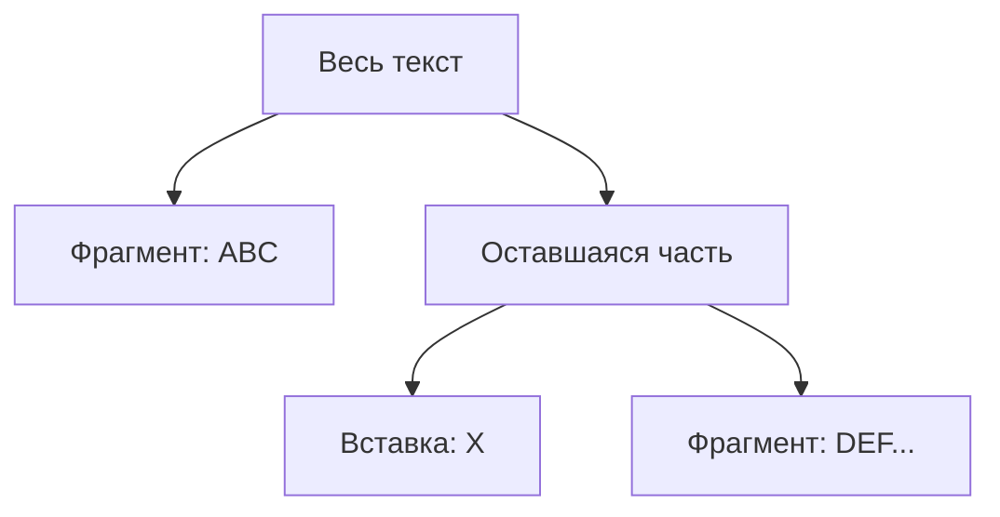
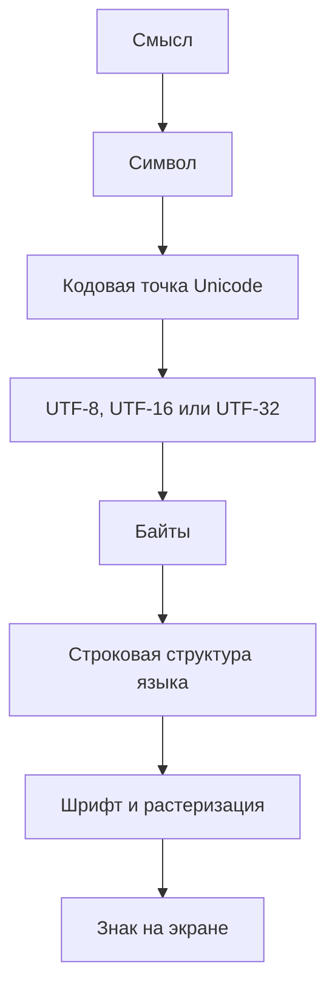

# Лекция 03 — Представление данных

[[Лекции по информатике и основам программирования|← К лекциям]]

> [!summary] Паспорт лекции
> **Курс:** «Информатика и основы программирования»  
> **Тема:** данные, кодирование, Unicode, шрифты и представление строк  
> **Сложность:** средняя; наиболее трудные части — Unicode и уровни представления строки  
> **Время чтения:** 35–45 минут  
> **Экзаменационная опора:** вопросы 3–4 — информация и данные; синтаксис и семантика; Unicode, UCS, UTF и композитные символы.

## 1. Программы, задачи и данные

**Важность: средняя. Рамка всей лекции.**

Продукт создаётся для решения проблемы или удовлетворения потребности. Внутри продукта формулируются **задачи** — результаты, которые:

- достижимы при наличии достаточных ресурсов;
- по возможности измеримы;
- решаются в условиях ограничений по времени, памяти, вычислениям и труду разработчиков.

Программисты пишут программы, решающие такие задачи. При этом программа работает только с формализованными представлениями — числами и последовательностями битов. Поэтому объект реального мира сначала требуется превратить в данные.

> [!important] Практический смысл
> Даже улучшение времени или расхода ресурсов на 5–10% может иметь большое значение в массовой системе. Представление данных влияет не только на корректность, но и на эффективность программы.

## 2. Что такое данные

**Важность: очень высокая. Определение желательно знать близко к тексту стандарта.**

> **Данные** — поддающееся многократной интерпретации представление информации в формализованном виде, пригодном для передачи, интерпретации или обработки.  
> ISO/IEC 2382:2015

Другое стандартное определение:

> **Данные** — формы представления информации, с которыми имеют дело информационные системы и их пользователи.  
> ISO/IEC 10746-2

### Что важно в определении

- **Представление информации:** данные не тождественны самой информации.
- **Формализованный вид:** существуют правила, по которым данные записываются и читаются.
- **Интерпретация:** одинаковая последовательность байтов может иметь разный смысл при разных правилах чтения.
- **Многократность:** данные можно сохранить, передать и интерпретировать снова.

> [!example] Пример
> Последовательность байтов сама по себе ещё не говорит, является ли она числом, текстом, изображением или частью команды процессора. Смысл появляется только после выбора формата и правил интерпретации.

## 3. Синтаксис и семантика

**Важность: очень высокая.**

### Определения

- **Синтаксис** — вид, начертание или форма представления.
- **Семантика** — смысл и правила трактовки конкретного представления.

Одно и то же начертание может восприниматься по-разному. Например, латинская `A` и кириллическая `А` выглядят почти одинаково, но являются разными символами:

```text
латинская A     → U+0041
кириллическая А → U+0410
```

Аналогично визуально похожий знак может быть буквой, математическим символом или частью другой системы обозначений.

Правильный смысл задают **стандарты и спецификации**. Реализация должна им соответствовать.

> **Верификация** — проверка соответствия реализации спецификации.

### Почему это важно при отладке

Код выполняется не так, как его интуитивно прочитал программист, а так, как предписывает спецификация языка и платформы. Например, арифметическая операция может сопровождаться переполнением; это часть семантики, даже если по внешнему виду выражения ожидается обычная школьная арифметика.

Пример формального синтаксиса на Haskell:

```haskell
merge [] xs = xs
merge (x:xs) ys = x : merge xs ys
```

Даже без знания языка по имени `merge` и общей форме можно предположить назначение функции, но точная семантика определяется спецификацией Haskell.

## 4. От физического мира к цифровым данным

**Важность: высокая.**

Изображение, голос, температура и свет в физическом мире существуют как **аналоговые сигналы** — непрерывно изменяющиеся физические величины. Программа обрабатывает только цифровые, то есть дискретные, значения.



### АЦП и ЦАП

- **АЦП** — аналого-цифровой преобразователь; переводит физический сигнал в цифровые данные.
- **ЦАП** — цифро-аналоговый преобразователь; превращает цифровые данные в физический сигнал.

Примеры АЦП: микрофон, камера, датчик температуры, радиоприёмник.  
Примеры ЦАП: динамик и дисплей.

Программа сама не создаёт звук: она обрабатывает числа, а колебания воздуха создаёт физическое устройство.

### Дискретизация и квантование

Оцифровка включает две независимые операции:

| Операция | Вопрос | Единица/параметр |
|---|---|---|
| **Дискретизация** | Как часто измеряется сигнал? | число отсчётов в секунду, Гц |
| **Квантование** | С какой точностью хранится один отсчёт? | число битов на отсчёт |

При квантовании реальное значение заменяется ближайшим представимым. Разница между ними образует **шум квантования**.

Пример аудио CD:

```text
44 100 Гц — частота дискретизации
16 бит    — глубина квантования одного отсчёта
```

По теореме Котельникова—Найквиста—Шеннона для восстановления сигнала частота дискретизации должна быть более чем вдвое выше максимальной частоты сигнала. Человек слышит примерно до 20 кГц, поэтому 44,1 кГц дают удвоенную частоту с запасом для фильтра.

## 5. Теория кодирования

**Важность: высокая.**

**Теория кодирования** изучает способы представления, хранения и передачи данных.

**Кодирование** — преобразование данных из формы, удобной для непосредственного использования, в форму, удобную для передачи, хранения, автоматической обработки или защиты от несанкционированного доступа.

### Основные направления

| Направление | Что меняется | Цель |
|---|---|---|
| Физическое кодирование | биты превращаются в физический сигнал | надёжная передача и синхронизация |
| Сжатие | убирается избыточность или часть содержимого | уменьшение объёма |
| Коррекция ошибок | добавляется контролируемая избыточность | обнаружение и исправление повреждений |
| Криптография | представление изменяется с использованием ключа | скрытие смысла от посторонних |

### Сжатие

Бит измеряет объём представления, а не содержательность информации. Уменьшение числа байтов не обязательно означает потерю информации.

- **Без потерь:** ZIP, PNG, FLAC. Исходные данные восстанавливаются байт в байт.
- **С потерями:** JPEG, MP3, H.264. Несущественная для восприятия часть удаляется без возможности точного восстановления.

Многократное сохранение в формате с потерями постепенно ухудшает результат.

### Коррекция ошибок

Избыточность специально добавляется, чтобы обнаруживать или исправлять повреждения:

- коды Рида—Соломона — компакт-диски и QR-коды;
- ECC — серверная память;
- LDPC — Wi‑Fi и 5G;
- коды Хэмминга — учебный пример обнаружения и исправления битовой ошибки.

### Криптография

Зашифрованные данные должны быть неинтерпретируемы без ключа и статистически напоминать случайную последовательность. В неудачных режимах, например ECB, одинаковые блоки исходных данных превращаются в одинаковые блоки шифротекста, поэтому структура изображения может остаться узнаваемой.

### Физическое кодирование

Описывает превращение битов в сигнал на проводе или в эфире: например, NRZ, манчестерское кодирование, 8b/10b. Здесь решаются задачи синхронизации приёмника и свойств физической линии.

## 6. Письменность как система кодирования

**Важность: низкая для экзамена, но объясняет происхождение текстовых кодировок.**

Письменность разделяет непрерывный поток речи на дискретные знаки. Уже здесь возникают основные задачи кодирования:

1. выбрать набор знаков;
2. договориться об их начертании;
3. обеспечить одинаковую интерпретацию пишущим и читающим.

Ключевые этапы:

- около 5,5 тысячи лет назад — шумерская клинопись, первоначально для учёта;
- примерно XI век до н. э. — финикийский алфавит с небольшим набором базовых знаков;
- 863 год — создание Кириллом глаголицы; кириллица возникла позднее в кругу его учеников;
- XV век — книгопечатание Гутенберга и физические литеры;
- 1707–1708 годы — гражданский шрифт Петра I и изменение набора русских знаков;
- 1963 год — появление ASCII: письменные знаки получают числовые коды.

## 7. ASCII

**Важность: очень высокая.**

**ASCII** (*American Standard Code for Information Interchange*) — 7-битная таблица кодирования. Она содержит `2^7 = 128` позиций: латинские буквы, цифры, знаки препинания и управляющие символы.

### Основные диапазоны

| Диапазон | Содержимое |
|---|---|
| `0x00–0x1F` | управляющие символы |
| `0x20–0x2F` | пробел и пунктуация |
| `0x30–0x39` | цифры `0–9` |
| `0x41–0x5A` | заглавные `A–Z` |
| `0x61–0x7A` | строчные `a–z` |

Примеры:

```text
'0' = 48 = 0x30
'A' = 65 = 0x41 = 0100 0001₂
'a' = 97 = 0x61 = 0110 0001₂
```

### Инженерные свойства ASCII

1. **Алфавитный порядок.** Буквы идут подряд, поэтому числовое сравнение кодов соответствует порядку букв внутри одного регистра.
2. **Смена регистра.** Между кодами заглавной и строчной буквы разница `0x20`, то есть один бит.
3. **Перевод цифры в число.** Цифры идут подряд; обычно используется выражение `c - '0'`.
4. **Шестнадцатеричные цифры `A–F` не идут сразу после `0–9`.** Между ними расположены знаки пунктуации, поэтому парсинг hex требует отдельной обработки.

Управляющие символы происходят от телетайпов: `LF` — перевод строки, `CR` — возврат каретки, `TAB` — табуляция, `BEL` — звонок. Они не печатаются, а задают действие.

> [!warning] Ограничение
> ASCII не содержит кириллицу, греческие буквы, иероглифы и большинство письменностей мира.

## 8. Кодовые страницы

**Важность: высокая.**

В 8-битных кодировках дополнительные 128 значений использовались по-разному. Появились **кодовые страницы**: CP437, CP866, KOI8-R, CP1251 и другие.

> **Кодовая страница** — таблица соответствия числовых значений байтов и символов.

Главная проблема:

```text
одинаковые байты + разные кодовые страницы = разные символы
```

Если программа выбирает неправильную таблицу, появляются «кракозябры», хотя байты файла могут быть полностью исправны.

### Пример с ZIP

Исторически ZIP мог не хранить кодировку имён файлов. Архиватор записывал имя в системной кодовой странице, а распаковщик читал в другой. Поэтому Windows-архив с русскими именами мог неверно распаковаться в GNU/Linux. Позднее в формат добавили флаг UTF-8, но старые архивы и программы всё ещё создают проблемы.

### KOI8-R

Кириллица расположена не в алфавитном порядке, а так, чтобы при потере восьмого бита текст превращался в узнаваемую транслитерацию:

```text
РУССКИЙ ТЕКСТ → rUSSKIJ tEKST
```

Это повышало устойчивость к старым 7-битным каналам, но ломало алфавитную сортировку сравнением кодов.

### CP1251 и буква `Ё`

В CP1251 `ё` находится отдельно от основного алфавитного диапазона. Поэтому наивные алгоритмы дают ошибки:

- сортировка по байтам не совпадает с алфавитной;
- проверка `'а' <= c && c <= 'я'` не распознаёт `ё`;
- смена регистра не сводится к одной одинаковой битовой операции для всех букв.

## 9. Unicode, UCS и UTF

**Важность: критическая. Основа экзаменационного вопроса 4.**

Unicode решает проблему множества несовместимых кодовых страниц, отделяя **сам символ и его номер** от **способа хранения этого номера в байтах**.



### Набор символов и кодовая точка

Unicode задаёт:

- какие символы существуют;
- уникальный номер каждого символа — **кодовую точку**;
- имя, категорию, письменность, направление письма и другие свойства.

Кодовая точка записывается как `U+XXXX`.

```text
латинская A      → U+0041
кириллическая А  → U+0410
Ѭ                → U+046C
```

Имя символа систематично, например `CYRILLIC CAPITAL LETTER IOTIFIED BIG YUS`. Имена Unicode после принятия не меняются даже при обнаружении ошибки — ради совместимости.

### UCS

**UCS** (*Universal Character Set*) — универсальный набор символов стандарта ISO/IEC 10646. Для текущего курса достаточно считать, что UCS/Unicode описывают набор символов и их кодовые точки.

### UTF

**UTF** (*Unicode Transformation Format*) — способ записать кодовые точки Unicode последовательностями байтов.

| Формат | Размер | Главное свойство |
|---|---:|---|
| **UTF-8** | 1–4 байта | ASCII хранится без изменений; вне ASCII используются многобайтовые последовательности |
| **UTF-16** | 2 или 4 байта | большинство кодовых точек занимает 2 байта, остальные — суррогатную пару |
| **UTF-32** | 4 байта | каждая кодовая точка занимает ровно 4 байта |

> [!important] Точная формулировка
> Не «Unicode занимает несколько байтов», а: **кодовая точка — числовой идентификатор; конкретный UTF определяет её байтовое представление**.

UTF-8 полностью совместим с ASCII: корректный ASCII-текст является корректным UTF-8 и имеет те же байты.

UTF-32 упрощает доступ к N-й кодовой точке, но расходует много памяти: ASCII-текст занимает в четыре раза больше байтов.

UTF-16 использует **суррогатные пары** для кодовых точек вне основной многоязычной плоскости. Поэтому в Java и JavaScript свойство `.length` может вернуть `2` для одного знака `𝄞`: оно считает 16-битные кодовые единицы, а не видимые символы.

### Представление строк в языках

- Go и Rust в типичных строковых представлениях используют UTF-8.
- Java, C#, JavaScript и Windows API исторически основаны на UTF-16.
- Python 3 внутренне выбирает компактное представление по содержимому строки.

Всегда требуется читать спецификацию конкретного языка и типа строки.

## 10. Блоки Unicode

**Важность: низкая/средняя. Диапазоны заучивать не требуется.**

Кодовые точки объединяются в смысловые блоки. Блок не обязан соответствовать одному языку, а символы одного языка могут находиться в нескольких блоках.

Кириллица размещена, в частности, в диапазонах:

```text
U+0400–U+052F
U+2DE0–U+2DFF
U+A640–U+A69F
```

Там находятся современные, дополнительные и исторические кириллические символы. Добавление нового символа сводится к его формальному описанию и назначению кодовой точки; алгоритмические UTF после этого могут представить его без создания новой кодовой страницы.

## 11. Композитные символы и нормализация

**Важность: критическая для понимания Unicode.**

Один видимый знак не всегда равен одной кодовой точке.

Буква `é` может быть записана двумя способами:

```text
U+00E9                 — одна готовая кодовая точка
U+0065 + U+0301        — e + комбинируемый акут
```

На экране варианты могут выглядеть одинаково, но последовательности кодовых точек и байтов различаются. Простое побайтовое сравнение способно вернуть неравенство.

### Формы нормализации

| Форма | Действие |
|---|---|
| **NFC** | по возможности собирает базовый символ и модификатор в составной символ |
| **NFD** | раскладывает составной символ на базовый и комбинируемый |
| **NFKC** | совместимая нормализация с последующей сборкой |
| **NFKD** | совместимая нормализация с разложением |

Буква `K` в NFKC/NFKD означает *compatibility*. Эти формы агрессивнее:

```text
fi → fi
① → 1
```

Поэтому NFKC/NFKD нельзя бездумно использовать для отображаемого текста: оформление и различия могут потеряться. Они полезны при сравнении идентификаторов и поиске, когда совместимые варианты требуется считать одинаковыми.

### Байт, кодовая точка и графемный кластер

| Уровень | Что считается единицей | Когда нужен |
|---|---|---|
| Байт | элемент физического представления | размер буфера, ввод-вывод, хранение |
| Кодовая точка | элемент Unicode | обработка символов стандарта |
| Графемный кластер | один знак с точки зрения человека | курсор, Backspace, обрезка и разворот текста |

Например, семейный эмодзи `👩‍👩‍👧‍👦` визуально является одним знаком, но состоит из нескольких эмодзи-кодовых точек и невидимых соединителей ZWJ.

> [!important] На вопрос «какова длина строки?» нельзя ответить без уточнения цели
> Для буфера нужны байты; для обхода Unicode — кодовые точки; для действий пользователя — графемные кластеры.

## 12. Unicode как развивающийся стандарт

**Важность: почти нулевая для экзамена.**

Unicode постоянно расширяется: добавляются современные и исторические письменности, математические знаки и эмодзи. На момент лекции Unicode 18.0 включал 172 808 символов, причём большая часть новых символов относилась к историческим письменностям, а не к эмодзи.

Точные числа заучивать не требуется. Важен вывод: Unicode — развивающийся стандарт, а не закрытая таблица.

## 13. Визуальное представление: гарнитуры и шрифты

**Важность: средняя как практический материал.**

Unicode определяет символ и его свойства, но не конкретный рисунок. Отображение задаёт шрифт.

- **Гарнитура** — семейство начертаний с общим характером рисунка, например JetBrains Mono.
- **Шрифт** в строгом смысле — конкретная гарнитура, размер и начертание, например JetBrains Mono Bold 14 pt.

### Моноширинные и пропорциональные гарнитуры

- В **моноширинной** гарнитуре все знаки занимают одинаковую ширину. Она подходит для кода, терминала, таблиц и ASCII-графики.
- В **пропорциональной** ширина зависит от знака. Она удобна для обычного текста, но хуже показывает структуру кода.

Тест программистской гарнитуры:

```text
0 O 1 l I
```

Эти знаки должны отчётливо различаться. Также важна различимость `;` и `:`, `,` и `.`, скобок и прямых/типографских кавычек.

### Лигатуры

Лигатура заменяет несколько отображаемых знаков одним глифом:

```text
!=  может выглядеть как  ≠
->  может выглядеть как  →
```

При этом в файле остаются исходные символы. Лигатура меняет только изображение, не данные и не семантику программы.

Недостатки лигатур:

- скрывается реальное число символов;
- похожие последовательности могут хуже различаться;
- курсор перемещается по исходным символам, хотя глаз видит один глиф;
- в diff и code review иногда полезнее видеть точный текст.

### Засечки

Засечки — небольшие штрихи на концах основных линий букв. Для экранного кода обычно выбираются гарнитуры без засечек: на пиксельной сетке они отображаются чище, особенно при невысоком разрешении.

## 14. Как устроены современные шрифты

**Важность: низкая.**

Современный шрифт хранит глифы не просто как растровые картинки, а как математические контуры из кривых Безье. Поэтому один глиф можно масштабировать для экрана и печати.

- TrueType обычно использует квадратичные кривые Безье второго порядка.
- PostScript/CFF — кубические кривые третьего порядка.
- OpenType является контейнером и может поддерживать разные способы описания.

### Растеризация и хинтинг

**Растеризация** превращает геометрический контур в пиксели или печатные точки.

**Хинтинг** — набор подсказок рендереру, помогающих согласовать контур с пиксельной сеткой: сохранить одинаковую толщину штрихов и избежать размытия. В TrueType подсказки могут быть байт-кодом для небольшой виртуальной машины — поэтому шрифт содержит не только данные, но и инструкции.

Принтер формирует полутона размещением точек; используются регулярные растры и алгоритмы диффузии ошибки, например Флойда—Стейнберга. Дисплей формирует цвет пикселя с помощью красного, зелёного и синего субпикселей. Старые системы применяли субпиксельное сглаживание; на HiDPI-экранах оно стало менее необходимо.

Цветные эмодзи потребовали хранить цветовые данные в шрифтах. Существуют разные форматы: COLR/CPAL, SVG-in-OpenType, sbix, CBDT/CBLC. Поэтому один символ может выглядеть по-разному на разных платформах.

Вариативный шрифт хранит оси параметров — насыщенность, ширину, наклон, оптический размер — и позволяет получать промежуточные значения из одного файла.

## 15. Представление строк в памяти

**Важность: очень высокая.**

Строка — это структура данных. Её устройство зависит от языка и определяет стоимость получения длины, создания подстроки, изменения и склеивания.

### 15.1. C-строка с нулевым терминатором

> **C-строка** — массив `char`, оканчивающийся специальным нулевым байтом `\0`.

```c
char s[] = "cat";
```

В памяти:

```text
'c' | 'a' | 't' | '\0'
```

Не всякий массив `char` является строкой:

```c
char a[3] = {'c', 'a', 't'}; // нет '\0', поэтому это не корректная C-строка
```

Свойства:

- длина отдельно не хранится;
- `strlen` идёт до `\0`, поэтому работает за `O(n)`;
- нулевой байт нельзя хранить внутри как обычные данные;
- функции без информации о размере буфера создают риск переполнения.

> [!warning] Частая ошибка
> Цикл `for (i = 0; i < strlen(s); ++i)` может работать за `O(n²)`, потому что `strlen` заново проходит строку на каждой итерации.

### 15.2. Строка с явной длиной

```text
[длина][данные]
```

Плюсы:

- получение длины за `O(1)`;
- нулевые байты внутри разрешены;
- границы известны структуре.

Минус: максимальная длина ограничена размером поля длины. В классическом Pascal поле в один байт позволяло длину не более 255.

### 15.3. Срез общего буфера

Строка или подстрока представляется парой:

```text
(указатель на начало, длина)
```

Примеры: строковые срезы в Go и `&str` в Rust.

Подстрока создаётся без копирования за `O(1)`, но общий буфер должен оставаться жив, пока существует хотя бы одна ссылка на его участок. Маленькая подстрока способна удерживать в памяти большой исходный буфер.

### 15.4. Неизменяемые строки и интернирование

**Неизменяемая строка** — строковый объект, содержимое которого нельзя поменять после создания.

```python
s = "cat"
s[1] = "o"       # ошибка
s = s + "s"      # создаётся новый объект "cats"
```

Преимущества:

- объект безопасно разделяется между несколькими владельцами;
- хеш можно вычислить один раз и кэшировать;
- строку удобно использовать как ключ хеш-таблицы;
- одинаковые строки можно интернировать, то есть хранить одним общим объектом.

Цена: каждое изменение создаёт новую строку. Многократная конкатенация в цикле может дать `O(n²)`; для неё применяют `StringBuilder` и аналоги.

### 15.5. SSO в C++

**SSO** (*Short String Optimization*) — хранение короткой строки прямо внутри объекта `std::string`, без отдельного выделения памяти в куче.

```text
короткая строка: [объект std::string содержит символы]
длинная строка:  [объект содержит указатель] → [буфер в куче]
```

Порог зависит от реализации, часто это примерно 15–22 символа. Программист обычно не управляет SSO вручную.

### 15.6. Rope

**Rope** («верёвка») хранит большой текст как дерево небольших фрагментов.



В обычном массиве вставка в середину требует сдвинуть большой хвост. В rope достаточно разбить или заменить небольшой узел и перестроить часть дерева. Поэтому структура подходит редакторам больших текстов с частыми вставками и удалениями.

Минусы: сложнее реализация, больше накладных расходов, доступ по индексу дороже, чем у сплошного массива. Для коротких строк rope невыгоден.

## 16. Почему сложно развернуть Unicode-строку

**Важность: высокая как практическое следствие.**

Для ASCII один знак занимает один байт:

```text
abc → cba
```

В UTF-8 одна кодовая точка может занимать несколько байтов. Если развернуть байты, порядок внутри многобайтовой последовательности нарушится, и строка станет некорректной.

```text
кириллическая А в UTF-8: D0 90
побайтовый разворот:     90 D0  ← некорректно
```

Разворот по кодовым точкам тоже не всегда корректен: комбинируемый акцент может отделиться от базовой буквы, а составной эмодзи — распасться.

Правильная единица для пользовательского текста — **графемный кластер**, то есть знак вместе со всеми модификаторами и соединителями.

Следовательно, перед задачами «развернуть строку» или «проверить палиндром» необходимо уточнить:

1. какая используется кодировка;
2. что считать одним символом;
3. нужна ли нормализация;
4. учитывать ли регистр;
5. можно ли менять исходные данные.

## 17. Полная цепочка представления текста



Каждый уровень отвечает на отдельный вопрос:

- Unicode — **какой это символ**;
- UTF — **какими байтами записать его кодовую точку**;
- строковый тип — **как организовать эти данные в памяти**;
- шрифт — **как нарисовать символ**.

---

# Краткая шпаргалка

## Определения

- **Данные** — формализованное представление информации, пригодное для передачи, интерпретации и обработки.
- **Синтаксис** — форма записи; **семантика** — её смысл.
- **Кодирование** — преобразование представления данных для хранения, передачи, обработки или защиты.
- **Кодовая точка** — числовой идентификатор символа в Unicode.
- **UTF** — способ записать кодовые точки Unicode байтами.
- **Графемный кластер** — один видимый знак с точки зрения пользователя.
- **C-строка** — массив `char`, завершённый `\0`.
- **Rope** — дерево фрагментов большого текста.

## Что нельзя путать

```text
информация ≠ данные
синтаксис ≠ семантика
дискретизация ≠ квантование
Unicode ≠ UTF
кодовая точка ≠ байт
кодовая точка ≠ видимый символ
кодировка ≠ шрифт
массив char ≠ обязательно C-строка
```

## UTF за 20 секунд

```text
Unicode: символ → номер U+....
UTF-8:   номер → 1–4 байта
UTF-16:  номер → 2 или 4 байта
UTF-32:  номер → 4 байта
```

## Ответ на экзаменационный вопрос про Unicode

Unicode — стандарт универсального набора символов. Он назначает символам уникальные кодовые точки и описывает их свойства. UCS — универсальный набор символов стандарта ISO/IEC 10646. UTF-8, UTF-16 и UTF-32 — способы представить кодовые точки последовательностями байтов. Один видимый знак может состоять из нескольких кодовых точек, например из буквы и комбинируемого акцента. Поэтому одинаково выглядящие строки могут иметь разное внутреннее представление; для приведения к общей форме используются NFC, NFD, NFKC и NFKD.

## Частые ошибки

1. Считать, что одна буква всегда занимает один байт.
2. Называть UTF-8 «таблицей символов» — это формат байтового представления.
3. Сравнивать визуально одинаковые Unicode-строки без нормализации.
4. Разворачивать UTF-8 побайтно.
5. Применять `strlen` к массиву `char` без гарантированного `\0`.
6. Вызывать `strlen` на каждой итерации цикла.
7. Считать, что лигатура меняет символы в исходном файле.
8. Путать строковую структуру языка со способом кодирования текста.


