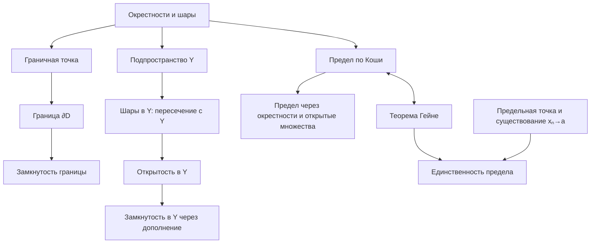

# Лекция 14 — Граница множества, подпространства и предел отображения

[[Лекции по матану|← К лекциям]]

Теоретическая тема: [[Метрики, линейные и нормированные пространства]].

> [!abstract] Содержание
> Граничные точки и граница множества → открытые и замкнутые множества в подпространстве → четыре определения предела отображения → замечания → эквивалентность определений Коши и Гейне → единственность предела.
>
> **Принцип изложения:** порядок соответствует лекционным записям. Дополнения и восстановленные доказательства отмечены отдельно. Все определения относятся к метрическим пространствам, если не оговорено иное.

## 1. Граничные точки и граница множества

Пусть $(X,\rho)$ — метрическое пространство, $D\subseteq X$, $a\in X$. Обозначим открытый шар радиуса $r>0$ с центром $a$ через

$$B_r^X(a)=\{x\in X:\rho(x,a)<r\}. $$

### 1.1. Граничная точка

**Определение.** Точка $a$ называется **граничной точкой множества $D$**, если любая её окрестность пересекается как с $D$, так и с его дополнением $X\setminus D$:

$$\boxed{\forall r>0:\quad B_r^X(a)\cap D\ne\varnothing\quad\land\quad B_r^X(a)\cap(X\setminus D)\ne\varnothing.}$$

При этом **$a$ не обязана принадлежать $D$**.

**Пример.** При $X=\mathbb R$ множества $D=(3,4)$ и $D=[3,4]$ имеют одинаковые граничные точки $3$ и $4$. Вокруг каждой из них в любом открытом интервале есть как точки из $D$, так и точки не из $D$.

### 1.2. Граница множества

**Определение.** Границей множества $D$ называется множество всех его граничных точек:

$$\boxed{\partial D=\{a\in X:a\text{ — граничная точка }D\}.}$$

Примеры в $\mathbb R$:

| Множество $D$ | Граница $\partial D$ |
|---|---|
| $(3,4)$ | $\{3,4\}$ |
| $[3,4]$ | $\{3,4\}$ |
| $\mathbb Q$ | $\mathbb R$ |
| $\{3\}$ | $\{3\}$ |
| $\varnothing$ | $\varnothing$ |

В случае $\mathbb Q$ любой интервал содержит и рациональные, и иррациональные числа.

### 1.3. Граница замкнута

**Утверждение из лекции:** для любого $D\subseteq X$ множество $\partial D$ замкнуто в $X$.

> [!note] Дополнение — доказательство через замыкания
> В записях это утверждение дано как упражнение; ниже приведено короткое доказательство с помощью ранее изученных свойств замыкания.

Вспомним: $a\in\overline D$ тогда и только тогда, когда **каждая** окрестность $a$ пересекает $D$. По определению граничной точки должны выполняться **два** таких условия — для $D$ и для $X\setminus D$. Поэтому

$$\boxed{\partial D=\overline D\cap\overline{X\setminus D}.}$$

**Доказательство.** Оба множества $\overline D$ и $\overline{X\setminus D}$ замкнуты как замыкания. Пересечение конечного числа замкнутых множеств замкнуто. Следовательно, $\partial D$ замкнуто. $\square$

**Почему это не противоречит определению замкнутости?** Множество замкнуто, когда содержит все свои предельные точки. Оно **может вообще не иметь** предельных точек: например, $\{3,4\}$ замкнуто в $\mathbb R$.

> [!warning] Предельная и граничная точки — не одно и то же
> - $a$ — **предельная точка** $D$, если $\forall r>0$ в $B_r(a)$ есть точка $D$, отличная от $a$.
> - $a$ — **граничная точка** $D$, если в каждом $B_r(a)$ есть точки из $D$ и из $X\setminus D$.
> - $D'=\{\text{предельные точки }D\}$ и $\overline D=D\cup D'$ — разные множества.
> - «Граница замкнута» означает, что **само множество $\partial D$** содержит все свои предельные точки, а не то, что исходное $D$ замкнуто.

---

## 2. Открытые и замкнутые множества в подпространстве

Пусть $(X,\rho)$ — метрическое пространство, $Y\subseteq X$. На $Y$ рассматривается **ограниченная метрика** $\rho|_{Y\times Y}$.

### 2.1. Шар в подпространстве

Для $a\in Y$, $r>0$:

$$\begin{aligned}
B_r^Y(a)&=\{y\in Y:\rho(y,a)<r\}\\
&=\{x\in X:\rho(x,a)<r\}\cap Y.
\end{aligned}$$

То есть

$$\boxed{B_r^Y(a)=B_r^X(a)\cap Y.}$$

**Смысл:** расстояния не изменяются, но в шаре остаются только точки, принадлежащие $Y$.

**Пример.** При $X=\mathbb R$, $Y=[3,4]$:

$$B_{0.1}^{\mathbb R}(3)=(2.9,3.1),\qquad B_{0.1}^{Y}(3)=[3,3.1).$$

Аналогично $B_{0.2}^Y(4)=(3.8,4]$. Крайние точки включаются или исключаются по строгому неравенству $\rho(x,a)<r$ и по принадлежности $Y$.

### 2.2. Критерий открытости в подпространстве

**Теорема.** Для $D\subseteq Y$:

$$\boxed{D\text{ открыто в }Y\iff\exists G\subseteq X:\ G\text{ открыто в }X,\quad D=G\cap Y.}$$

#### Доказательство, направление $\Rightarrow$

**Дано:** $D$ открыто в $Y$. **Требуется:** построить открытое $G\subseteq X$ с $D=G\cap Y$.

1. Для каждой точки $a\in D$ из открытости $D$ в $Y$ следует существование радиуса $r_a>0$ такого, что $B_{r_a}^{Y}(a)\subseteq D$.
2. По формуле для шаров $B_{r_a}^{X}(a)\cap Y\subseteq D$.
3. Определим

   $$G=\bigcup_{a\in D}B_{r_a}^{X}(a).$$

   Множество $G$ открыто в $X$ как объединение открытых шаров. Если $D=\varnothing$, берём $G=\varnothing$.
4. По распределительному закону

   $$\begin{aligned}
   G\cap Y
   &=\left(\bigcup_{a\in D}B_{r_a}^{X}(a)\right)\cap Y\\
   &=\bigcup_{a\in D}\bigl(B_{r_a}^{X}(a)\cap Y\bigr)
   =\bigcup_{a\in D}B_{r_a}^{Y}(a).
   \end{aligned}$$

   Каждый шар в объединении содержится в $D$, значит $G\cap Y\subseteq D$. С другой стороны, каждая точка $a\in D$ принадлежит своему шару $B_{r_a}^Y(a)$; следовательно, $D\subseteq G\cap Y$. Таким образом, $G\cap Y=D$. $\square$

#### Доказательство, направление $\Leftarrow$

**Дано:** $D=G\cap Y$, где $G$ открыто в $X$. **Требуется:** доказать открытость $D$ в $Y$.

1. Возьмём произвольную точку $a\in D$. Тогда $a\in G$ и $a\in Y$.
2. Поскольку $G$ открыто в $X$, найдётся $r>0$ с $B_r^X(a)\subseteq G$.
3. Пересечём с $Y$:

   $$B_r^Y(a)=B_r^X(a)\cap Y\subseteq G\cap Y=D.$$

   Значит, каждая точка $D$ внутренняя относительно $Y$, и $D$ открыто в $Y$. $\square$

**Пример.** При $Y=[3,4]$ множество $D=[3,4)$ открыто в $Y$, потому что $D=(2,4)\cap Y$, где $G=(2,4)$ открыто в $\mathbb R$. При этом $D$ **не открыто** в $\mathbb R$.

### 2.3. Критерий замкнутости в подпространстве

**Теорема.** Для $D\subseteq Y$:

$$\boxed{D\text{ замкнуто в }Y\iff\exists F\subseteq X:\ F\text{ замкнуто в }X,\quad D=F\cap Y.}$$

> [!note] Дополнение — полное доказательство
> В лекции сформулирован критерий; доказательство ниже восстановлено через дополнения и только что доказанный критерий открытости.

#### Доказательство, направление $\Rightarrow$

1. Пусть $D$ замкнуто в $Y$. Тогда $Y\setminus D$ открыто в $Y$.
2. По критерию открытости существует **открытое в $X$** множество $G$ с

   $$Y\setminus D=G\cap Y.$$

3. Положим $F=X\setminus G$. Оно **замкнуто в $X$**, поскольку $G$ открыто в $X$.
4. Проверим требуемое равенство:

   $$\begin{aligned}
   D&=Y\setminus(Y\setminus D)\\
    &=Y\setminus(G\cap Y)\\
    &=Y\cap(X\setminus G)\\
    &=Y\cap F=F\cap Y.
   \end{aligned}$$

   В третьем переходе используется $Y\setminus(G\cap Y)=Y\cap(X\setminus G)$: из $x\in Y$ и $x\notin(G\cap Y)$ следует $x\notin G$, и наоборот. Получили замкнутое $F$ с $D=F\cap Y$. $\square$

#### Доказательство, направление $\Leftarrow$

1. Пусть $D=F\cap Y$, где $F$ замкнуто в $X$.
2. Тогда $X\setminus F$ открыто в $X$.
3. Дополнение $D$ в $Y$ имеет вид:

   $$Y\setminus D=Y\setminus(F\cap Y)=Y\cap(X\setminus F).$$

4. По критерию открытости $Y\cap(X\setminus F)$ открыто в $Y$. Значит, дополнение $Y\setminus D$ открыто в $Y$, а $D$ замкнуто в $Y$. $\square$

**Пример.** $Y=(0,5)$, $D=(0,2]$. Возьмём $F=[0,2]$, замкнутое в $\mathbb R$. Тогда $F\cap Y=(0,2]=D$; следовательно, $D$ замкнуто в $Y$, хотя не замкнуто в $\mathbb R$.

### 2.4. Итог по подпространствам

| Вопрос | Критерий |
|---|---|
| Шар в $Y$ | $B_r^Y(a)=B_r^X(a)\cap Y$ |
| $D$ открыто в $Y$ | $D=G\cap Y$, $G$ открыто в $X$ |
| $D$ замкнуто в $Y$ | $D=F\cap Y$, $F$ замкнуто в $X$ |

> [!warning] Типичная ошибка
> В критерии **не требуется**, чтобы само $D$ было открыто или замкнуто в $X$. Соответствующее свойство требуется от вспомогательного $G$ или $F$ **в пространстве $X$**.

---

## 3. Предел отображения между метрическими пространствами

Пусть $(X,\rho_X)$ и $(Y,\rho_Y)$ — метрические пространства, $D\subseteq X$, $f:D\to Y$, $a\in X$ — **предельная точка** $D$, $L\in Y$.

**Определение.** $\lim_{x\to a}f(x)=L$, если выполнено одно (а значит, любое) из следующих четырёх эквивалентных условий.

### 3.1. Определение Коши ($\varepsilon$–$\delta$)

$$\boxed{\forall\varepsilon>0\ \exists\delta>0\ \forall x\in D:\quad 0<\rho_X(x,a)<\delta\ \Longrightarrow\ \rho_Y(f(x),L)<\varepsilon.}$$

Сначала **задаётся** точность $\varepsilon$ для значений $f(x)$; под неё **подбирается** $\delta$ для аргументов $x$. Выбранное $\delta$ должно подходить для **всех** допустимых $x$ из проколотого $\delta$-шара.

Условие $0<\rho_X(x,a)$ исключает $x=a$: значение $f(a)$ не определяет предел.

### 3.2. Определение на языке окрестностей

Для любой окрестности $U(L)$ в $Y$ должна существовать окрестность $V(a)$ в $X$ такая, что

$$\boxed{f\bigl((V(a)\cap D)\setminus\{a\}\bigr)\subseteq U(L).}$$

Полная запись:

$$\forall U(L)\ \exists V(a)\ \forall x\in (V(a)\cap D)\setminus\{a\}:\ f(x)\in U(L).$$

**Смысл:** для любой, сколь угодно маленькой целевой окрестности $L$ можно подобрать подходящую окрестность $a$, все допустимые точки которой отображаются внутрь целевой.

**Порядок кванторов важен:** $\forall U(L)\ \exists V(a)$, а не наоборот. При обратном порядке одну и ту же входную окрестность пришлось бы отображать сразу внутрь **каждой** окрестности $L$, что потребовало бы $f(x)=L$ в некоторой проколотой окрестности $a$.

**Пример.** Для $f(x)=2x$, $a=1$, $L=2$: если $U(2)=(1.8,2.2)$, подойдёт $V(1)=(0.9,1.1)$, поскольку $x\in V(1)\Rightarrow 2x\in U(2)$.

### 3.3. Определение Гейне (через последовательности)

$$\boxed{\forall(x_n):\quad [x_n\in D,\ x_n\ne a,\ x_n\to a]\ \Longrightarrow\ f(x_n)\to L.}$$

**Важно:** для подтверждения предела необходимо рассмотреть **все** допустимые последовательности. Для опровержения утверждения о едином пределе достаточно предъявить последовательность, для которой $f(x_n)\not\to L$. Для опровержения существования предела удобно найти две последовательности, сходящиеся к $a$, у которых образы имеют разные пределы.

### 3.4. Определение через открытые множества

В записи лекции четвёртый вариант сформулирован **именно через открытые множества**, а не через отдельный повтор определения с шарами.

$$\boxed{\begin{gathered}
\forall G\subseteq Y:\ [G\text{ открыто в }Y,\ L\in G]\ \\
\Longrightarrow\ \exists F\subseteq X:\ [F\text{ открыто в }X,\ a\in F]\\
\text{и }\forall x\in(F\cap D)\setminus\{a\}:\quad f(x)\in G.
\end{gathered}}$$

**Смысл:** целевая окрестность задаётся **открытым множеством** $G$, а исходная — **открытым множеством** $F$.

**Связь со вторым определением:** в метрическом пространстве всякая окрестность точки содержит открытый шар вокруг неё. Поэтому можно переходить между произвольными окрестностями и открытыми множествами, содержащими соответствующие точки.

### 3.5. Замечания из лекции (перед теоремой Коши — Гейне)

**Замечание 1.** Если $a\in D$, значение $f(a)$ **не влияет** на $\lim_{x\to a}f(x)$: рассматриваются только $x\ne a$.

**Замечание 2.** В определениях можно рассматривать пределы при $x\to\pm\infty$ (для неограниченных областей $D\subseteq\mathbb R$) и бесконечные пределы значений функции.

В конспекте лекции отдельно указан случай:

$$\lim_{x\to+\infty}f(x)=-\infty,$$

при этом $D\subseteq\mathbb R$ не ограничено сверху. Приведены две эквивалентные формулировки:

1. Через окрестности: для любой окрестности $U(-\infty)$ существует окрестность $V(+\infty)$, такая что $f(x)\in U(-\infty)$ при всех $x\in D\cap V(+\infty)$.
2. Через неравенства:

   $$\boxed{\forall A\in\mathbb R\ \exists b\in\mathbb R\ \forall x\in D:\quad x>b\ \Longrightarrow\ f(x)<A.}$$

Здесь $\pm\infty$ не являются обычными точками $\mathbb R$: окрестности бесконечностей понимаются как лучи, например $V(+\infty)=(b,+\infty)$ и $U(-\infty)=(-\infty,A)$.

> [!info] Граница лекционного материала
> Остальные сочетания бесконечных пределов здесь специально не разворачиваются в новые формулировки: они не выписаны подробно в предоставленных записях.

---

## 4. Теорема об эквивалентности определений Коши и Гейне

### 4.1. Формулировка

В обозначениях раздела 3 условия

1. $\lim_{x\to a}f(x)=L$ по Коши;
2. для всякой последовательности $x_n\in D\setminus\{a\}$, $x_n\to a$ выполняется $f(x_n)\to L$

**эквивалентны**.

### 4.2. Доказательство: Коши $\Rightarrow$ Гейне

**Дано:** для любого $\varepsilon>0$ существует $\delta>0$, такое что

$$\forall x\in D:\quad 0<\rho_X(x,a)<\delta\implies\rho_Y(f(x),L)<\varepsilon.$$

**Требуется:** для всякой последовательности $x_n\in D\setminus\{a\}$, $x_n\to a$ доказать $f(x_n)\to L$.

1. Зафиксируем произвольное $\varepsilon>0$ и выберем соответствующее $\delta>0$ из условия Коши.
2. Возьмём **произвольную допустимую последовательность** $(x_n)$ с $x_n\to a$.
3. По определению сходимости существует $N\in\mathbb N$, такое что при всех $n\ge N$:

   $$\rho_X(x_n,a)<\delta.$$

4. Так как $x_n\ne a$, имеем $0<\rho_X(x_n,a)<\delta$.
5. По условию Коши для каждого $n\ge N$:

   $$\rho_Y(f(x_n),L)<\varepsilon.$$

6. Это определение сходимости $f(x_n)\to L$. Поскольку последовательность была произвольной, условие Гейне выполнено. $\square$

**Суть:** последовательность, стремящаяся к $a$, с некоторого номера попадает в любой подходящий $\delta$-шар, а по Коши все допустимые точки этого шара имеют образы близко к $L$.

### 4.3. Доказательство: Гейне $\Rightarrow$ Коши (от противного)

**Дано:** для каждой последовательности $x_n\in D\setminus\{a\}$ с $x_n\to a$ выполнено $f(x_n)\to L$.

**Требуется:** доказать условие Коши.

1. **Предположим противное:** условие Коши неверно. Его отрицание имеет вид

   $$\boxed{\exists\varepsilon_0>0\ \forall\delta>0\ \exists x\in D:\quad 0<\rho_X(x,a)<\delta\quad\land\quad\rho_Y(f(x),L)\ge\varepsilon_0.}$$

   Это означает: для **одного фиксированного** $\varepsilon_0>0$ при **каждом** радиусе $\delta$ найдётся точка, образ которой остаётся от $L$ на расстоянии хотя бы $\varepsilon_0$.

2. Для каждого $n\in\mathbb N$ возьмём $\delta_n=1/n$. Из отрицания Коши существует точка $x_n\in D$, удовлетворяющая **сразу двум условиям**:

   $$\boxed{0<\rho_X(x_n,a)<\frac1n,\qquad \rho_Y(f(x_n),L)\ge\varepsilon_0.}$$

3. Поскольку $0\le\rho_X(x_n,a)<1/n$ и $1/n\to0$, по теореме о зажатой последовательности $\rho_X(x_n,a)\to0$. Значит, $x_n\to a$. Кроме того, $x_n\ne a$ по строгому неравенству слева.
4. По условию Гейне **для этой же последовательности** должно выполняться $f(x_n)\to L$, то есть $\rho_Y(f(x_n),L)\to0$.
5. Но по построению $\rho_Y(f(x_n),L)\ge\varepsilon_0>0$ **для каждого $n$**. Такая последовательность расстояний не может стремиться к нулю: в определении сходимости достаточно выбрать точность $\varepsilon=\varepsilon_0$.
6. Противоречие. Следовательно, предположение о неверности Коши ложно, и условие Коши выполняется. $\square$

**Ключевой логический узел:** по Гейне *любая* допустимая последовательность должна давать образы, сходящиеся к $L$, а отрицание Коши позволяет специально построить допустимую последовательность, для которой это невозможно.

**Почему выбрано $1/n$?** Нужна последовательность положительных радиусов, стремящихся к нулю. Подошли бы, например, $2^{-n}$; выбор $1/n$ лишь удобен.

### 4.4. Сравнение двух направлений

| Направление | Основной ход |
|---|---|
| Коши $\Rightarrow$ Гейне | Берём **любую** последовательность; сходимость переносит её точки в $\delta$-шар, а Коши — образы в $\varepsilon$-шар |
| Гейне $\Rightarrow$ Коши | **Отрицаем Коши**, строим «плохую» последовательность $x_n\to a$, противоречащую Гейне |

---

## 5. Теорема о единственности предела

**Теорема.** Пусть $f:D\to Y$, где $D\subseteq X$, $a$ — предельная точка $D$, $L,M\in Y$. Если

$$\lim_{x\to a}f(x)=L\qquad\text{и}\qquad \lim_{x\to a}f(x)=M,$$

то

$$\boxed{L=M.}$$

> [!note] Дополнение — доказательство по Гейне
> В предоставленных записях приведена формулировка теоремы и начало доказательства, но полный текст доказательства не виден. Ниже — самостоятельное восстановление через теорему Гейне.

### Доказательство

1. Поскольку $a$ — предельная точка $D$, существует последовательность $x_n\in D\setminus\{a\}$, стремящаяся к $a$. Это **другая, ранее изученная теорема** — критерий предельной точки через последовательности:

   $$\boxed{a\in D'\iff\exists(x_n):\quad x_n\in D\setminus\{a\},\quad x_n\to a.}$$

2. По теореме Гейне из $\lim_{x\to a}f(x)=L$ следует $f(x_n)\to L$.
3. Из $\lim_{x\to a}f(x)=M$ по той же теореме следует $f(x_n)\to M$.
4. Получилось, что последовательность $(f(x_n))$ имеет одновременно пределы $L$ и $M$. Но предел последовательности в метрическом пространстве единственен.
5. Следовательно, $L=M$. $\square$

**Разница двух теорем, используемых в доказательстве:**

- Критерий предельной точки: гарантирует существование **хотя бы одной** последовательности из $D\setminus\{a\}$, стремящейся к $a$.
- Теорема Гейне: говорит об образах **всех** таких последовательностей при наличии предела функции.

---

## 6. Типичные ошибки и тонкости

1. **Путать $D'$ и $\overline D$.** Предельные точки образуют $D'$, а замыкание — $\overline D=D\cup D'$.
2. **Считать, что у замкнутого множества обязательно есть предельные точки.** Замкнутость требует содержать все имеющиеся предельные точки, даже если их нет.
3. **Проверять открытость $D$ в $Y$ обычными шарами в $X$.** Используются $B_r^Y(a)=B_r^X(a)\cap Y$.
4. **Выбирать $G=D$ в критерии открытости, не проверив открытость $G$ в $X$.** Например, $[3,4)$ открыто в $[3,4]$, но не в $\mathbb R$; подходящее $G=(2,4)$.
5. **Путать дополнения относительно $Y$ и $X$.** $Y\setminus D$ — дополнение в подпространстве, $X\setminus G$ — дополнение в исходном пространстве. Это существенно при построении замкнутого $F=X\setminus G$.
6. **Менять порядок кванторов $\forall\varepsilon\ \exists\delta$ или $\forall U(L)\ \exists V(a)$.** Допустимая входная окрестность выбирается *в ответ* на заданную точность выхода.
7. **Забывать $x_n\ne a$ в Гейне.** Функция в $a$ может быть не определена, и её значение не должно влиять на предел.
8. **Пытаться доказать предел двумя удачными последовательностями.** Две последовательности могут опровергнуть существование предела, но для доказательства требуется условие для всех.
9. **Не удерживать отрицание Коши.** Отрицание содержит фиксированное $\varepsilon_0>0$ и «плохую» точку для **каждого** $\delta>0$. Именно поэтому выбирают $\delta_n=1/n$.
10. **Путать две последовательностные теоремы.** Критерий предельной точки утверждает существование последовательности; теорема Гейне описывает образы каждой допустимой последовательности.

---

## 7. Карта связей (для повторения)

### Мини-шпаргалка

$$\begin{gathered}
\partial D=\overline D\cap\overline{X\setminus D},\\[3pt]
B_r^Y(a)=B_r^X(a)\cap Y,\\[3pt]
D\text{ открыто в }Y\iff D=G\cap Y\ (G\text{ открыто в }X),\\[3pt]
D\text{ замкнуто в }Y\iff D=F\cap Y\ (F\text{ замкнуто в }X),\\[3pt]
\lim_{x\to a}f(x)=L\iff\forall(x_n)\subseteq D\setminus\{a\}:\ x_n\to a\Rightarrow f(x_n)\to L.
\end{gathered}$$

---

## 8. Вопросы для самопроверки

1. Чем граничная точка отличается от предельной? Обязательно ли граничная точка принадлежит исходному множеству?
2. Чему равны $\partial(3,4)$, $\partial[3,4]$, $\partial\mathbb Q$ в $\mathbb R$?
3. Почему множество без предельных точек может быть замкнутым?
4. Что означает $\overline{X\setminus D}$ и почему $\partial D=\overline D\cap\overline{X\setminus D}$?
5. Почему $B_{0.2}^{[3,4]}(4)=(3.8,4]$, а не $[3.8,4]$?
6. Как проверить, что $[3,4)$ открыто в $Y=[3,4]$?
7. Докажите критерий открытости в подпространстве в обе стороны.
8. Докажите критерий замкнутости в подпространстве в обе стороны, используя дополнения.
9. Чем определения предела по Коши, через окрестности, по Гейне и через открытые множества различаются **формой**, а не содержанием?
10. Почему в определении Коши нужно $0<\rho_X(x,a)$?
11. Почему из Коши следует Гейне?
12. Как отрицать определение Коши? Каким образом из отрицания получается «плохая» последовательность?
13. В чём именно противоречие при доказательстве Гейне $\Rightarrow$ Коши?
14. Почему в доказательстве единственности предела можно выбрать последовательность $x_n\to a$ из $D\setminus\{a\}$?
15. Почему $+\infty$ и $-\infty$ не рассматриваются как обычные точки $\mathbb R$?

> [!summary] Итог
> Главная идея лекции — одно и то же свойство можно выразить на языке **шаров**, **окрестностей**, **открытых множеств** или **последовательностей**. Важнее понимать связи между этими формами, чем учить каждую формулу изолированно.

