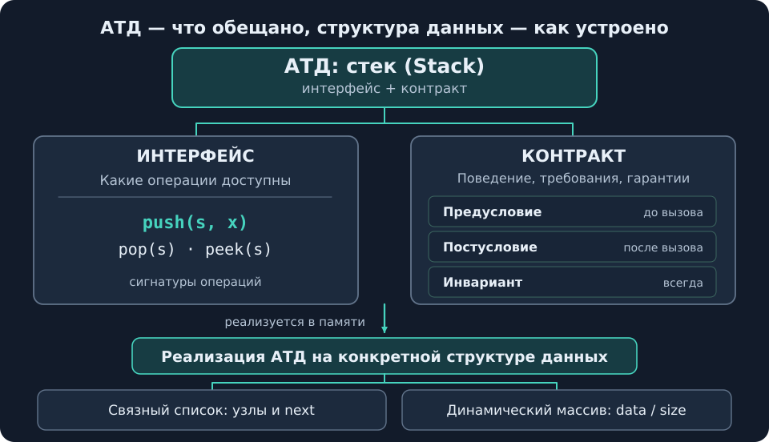
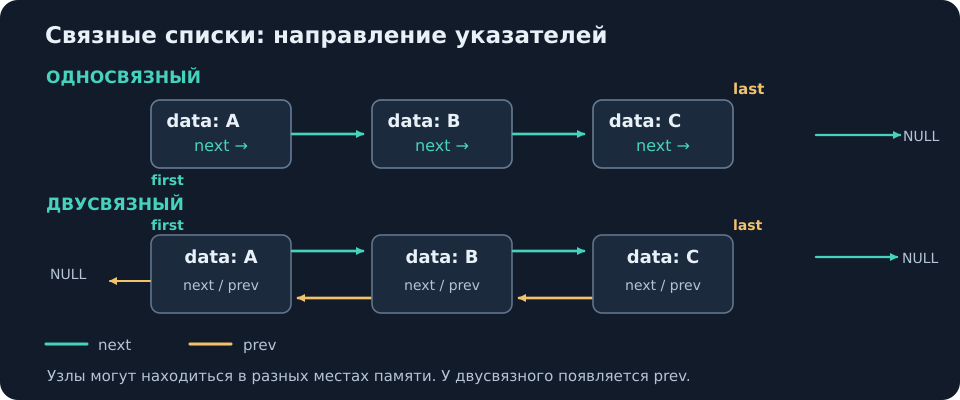
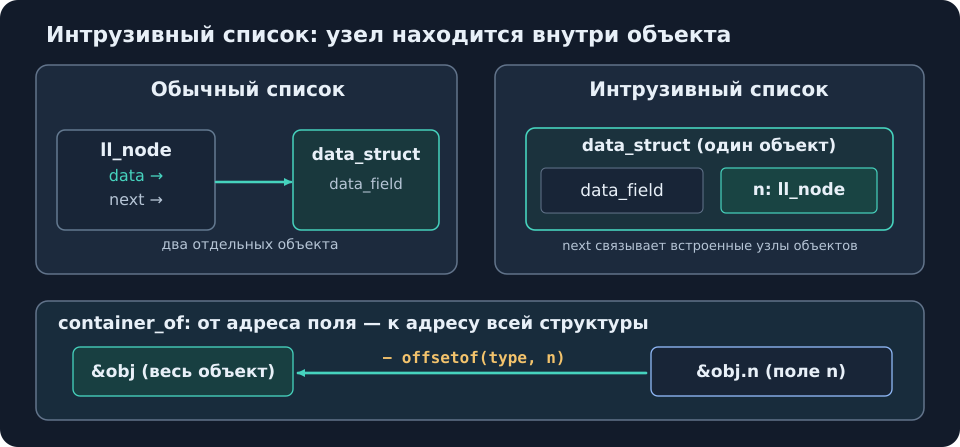
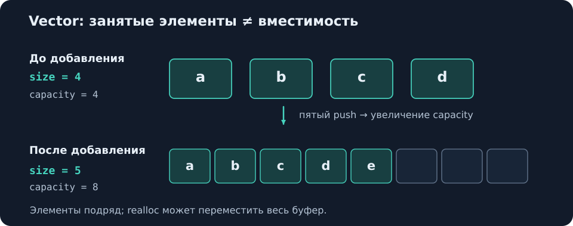
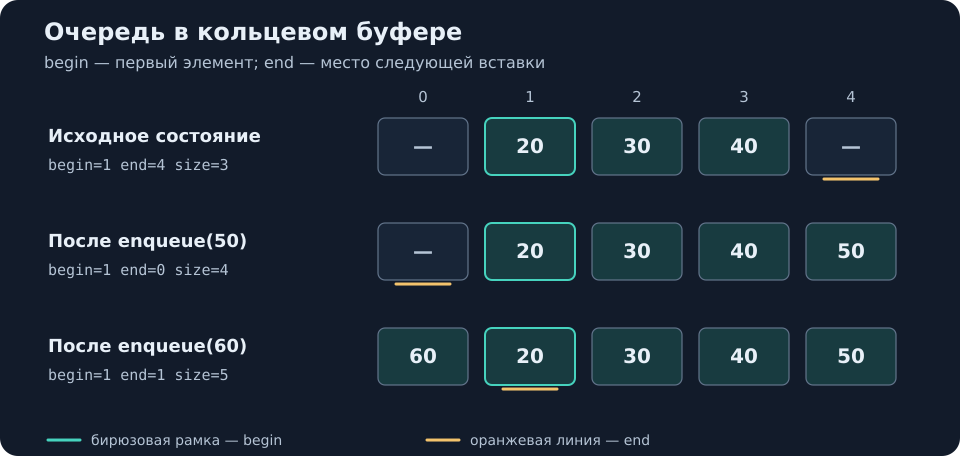

# Лекция 05 — Структуры данных

[[Лекции по программированию на C|← К лекциям]]

> **Источник:** В. А. Кутуев, А. И. Васенина, СПбГУ, «Структуры данных», 19.10.2026; 33 слайда (в PDF 40 страниц из-за появления элементов слайдов).\\
> **Нумерация:** в хранилище материал оформлен как лекция 05; в исходном PDF номер не указан.
> **Назначение:** компактное повторение к летучке. Обозначения: $n$ — число элементов; $O(1)$ — постоянное время, $O(n)$ — линейное.

**Быстрая навигация:** [[#1. Интерфейс, контракт, АТД (слайды 2–6)|АТД]] · [[#2. Список — List (слайды 7–9)|List]] · [[#3. Связные списки (слайды 10–15)|Linked List]] · [[#4. Интрузивный список (слайды 16–17)|Intrusive]] · [[#5. Динамический массив — Vector (слайды 18–21)|Vector]] · [[#6. Стек — Stack (слайды 22–25)|Stack]] · [[#7. Очередь — Queue (слайды 26–27)|Queue]] · [[#8. Словарь — Dictionary / Map (слайды 28–30)|Map]] · [[#9. Множество — Set (слайды 31–33)|Set]] · [[#10. Сводка для летучки|Сводка]].

## 1. Интерфейс, контракт, АТД (слайды 2–6)

> **Определение — абстрактный тип данных (АТД).** Тип данных, заданный **набором операций и их поведением**, а не устройством в памяти. **АТД = интерфейс + контракт.** Классические АТД: список, стек, очередь, словарь, множество.
>
> **Интерфейс** — какие операции существуют. **Контракт** — что они делают и при каких условиях. **Структура данных** — конкретная реализация АТД в памяти: один АТД можно реализовать разными структурами.


*Рис. 1. Иерархия: АТД состоит из интерфейса и контракта; реализация определяет устройство в памяти.*

| Часть контракта | Смысл                               | Пример из лекции                                            |
| --------------- | ----------------------------------- | ----------------------------------------------------------- |
| **Предусловие** | Что должно быть верно **до** вызова | `pop(s)` требует непустой стек                              |
| **Постусловие** | Что гарантируется **после** вызова  | `push(s, x)` кладёт `x` на вершину, увеличивает размер на 1 |
| **Инвариант**   | Что должно быть верно **всегда**    | Во множестве нет повторов                                   |

**Нарушение предусловия** также описывается контрактом: код ошибки, `NULL` или неопределённое поведение (UB), как при `strcpy` в слишком маленький буфер. В собственном коде UB желательно избегать. **АТД (абстрактный тип данных) не путать с алгебраическим типом данных**: аббревиатура совпадает, понятия разные.

### Зачем отделять интерфейс от хранения (слайды 2–4)

**C-строки:** функции `string.h` привязаны к представлению «массив `char`, заканчивающийся `\0`»:

```c
char buf[32];
strcpy(buf, "Hello, "); /* а влезет? */
strcat(buf, name);
size_t len = strlen(buf); /* O(n) каждый раз */
```

Проблемы: код по всей программе знает устройство строки; размер буфера может оказаться недостаточным; `strlen` каждый раз идёт до `\0` за $O(n)$. Чтобы хранить длину отдельно, растить буфер или разрешать нулевые байты внутри строки, пришлось бы менять обращения к данным по всей программе. **Нужен интерфейс, скрывающий устройство.**

**Скрытая реализация на практике:**

```c
FILE *f = fopen("data.txt", "r");
fgets(buf, sizeof buf, f);
fclose(f);
```

Пользователь вызывает операции, не зная внутреннего устройства `FILE`. У `malloc/free` также бывают разные реализации; их устройство рассматривается позже в курсе.

**Одного интерфейса недостаточно:**

```c
/* box.h */
struct box;
void box_put(struct box *b, int x);
int box_take(struct box *b);

/* main.c */
box_put(b, 1); box_put(b, 2); box_put(b, 3);
box_take(b);   /* что вернёт? */
```

По сигнатурам нельзя понять результат: **`3` при LIFO (стек)** или **`1` при FIFO (очередь)**. Поведение определяет **контракт**, а не только интерфейс.

## 2. Список — List (слайды 7–9)

**Список** — АТД упорядоченной последовательности. Возможные операции: **добавить / удалить / получить / изменить** элемент (в начале, в конце, по индексу); узнать число элементов; обойти элементы (`foreach`). Обход не обязателен для любого минимального интерфейса списка. Дополнительные возможные операции: обратный обход, проверка пустоты, поиск по значению.

### Контракт списка

Пусть `size(l) = n`.

| Операция | Предусловие | Постусловие / действие |
|---|---|---|
| `get(l, i)` | `0 <= i < n` | Получить элемент по индексу |
| `set(l, i, x)` | `0 <= i < n` | `get(l, i) == x`; **остальные элементы не изменились** |
| `insert(l, i, x)` | **`0 <= i <= n`** | `get(l, i) == x`; правые элементы сдвинуты на 1, размер +1 |
| `remove(l, i)` | `0 <= i < n` | Правые элементы сдвинуты влево на 1, размер −1 |

`insert(l, size(l), x)` допустим — вставка в конец. `get/set/remove` по индексу `size(l)` недопустимы. **Обход** — в порядке индексов `0, 1, …, size(l)−1`. **Инвариант:** порядок элементов меняется только через `insert` и `remove`.

### Интерфейс списка в C — исходный пример

```c
struct list; /* реализация скрыта */
struct list *list_new(void);
void list_free(struct list *l);
int list_push_back(struct list *l, void *item);
void *list_pop_front(struct list *l);
size_t list_size(const struct list *l);
```

- `struct list;` скрывает поля; реализацию можно заменить без изменения пользовательского кода.
- `list_push_back` возвращает **`-1` при ошибке** (например, не хватило памяти при `malloc`), а не молча пропускает добавление.
- `list_pop_front` возвращает **`NULL` при пустом списке**; на слайде также упомянут вариант с выходным (`out`) параметром.
- **Владение памятью:** `list_free` освобождает **узлы списка**, но **не сами объекты по `item`** — ими распоряжается вызывающий код. Это важно при совместном использовании объектов несколькими списками.

## 3. Связные списки (слайды 10–15)

> **Определение — узел (`ll_node`).** Отдельная запись списка с данными (`data`) и указателем на следующий узел (`next`). Последний `next` обычно `NULL` (редко используют циклические ссылки). Узлы не обязаны находиться подряд в памяти.

```c
struct ll_node {
    void *data;
    struct ll_node *next;
};
```

`data` имеет тип `void *`, чтобы список мог хранить указатели на данные разных типов. **Поиск по индексу — $O(n)$**, поскольку нужно идти по цепочке `next`.


*Рис. 2. Связный список: `first`, `last`, направление `next` и дополнительное `prev`.*

### От указателя на голову к структуре списка (слайды 11–12)

Изначально список можно представить указателем на первый узел. Отдельная управляющая структура позволяет хранить метаданные и не путать тип «весь список» с типом «узел»:

```c
struct linked_list {
    struct ll_node *first;
    size_t size;
};
```

`first` — первый узел, `size` — число узлов (узнать размер теперь $O(1)$). При вставке в начало важно **сначала** связать новый узел со старой головой и **затем** обновить `first`; различение типов списка и узла уменьшает риск начать обход не с первого элемента.

### Указатель на конец и двусвязность (слайды 13–15)

**Односвязный список с `last`:**

```c
struct linked_list {
    struct ll_node *first;
    struct ll_node *last;
    size_t size;
};
```

`last` позволяет **добавить в конец** и **получить последний элемент** за $O(1)$; его надо поддерживать при вставках и удалениях. Но для **удаления последнего** нужно найти предпоследний узел — по-прежнему $O(n)$.

**Двусвязный список:** к узлу добавляется `struct ll_node *prev;`, а контейнер хранит `first`, `last`, `size`. Теперь `last->prev` — предпоследний узел, так что **удаление последнего — $O(1)$**. При этом поиск по значению, доступ по индексу к середине и вставка/удаление **в середине без готового указателя на узел** всё ещё требуют обхода (всего списка или его части).

> Отдельная сводка временных сложностей для всех реализаций списка — в разделе 5 (таблица со слайда 20).

## 4. Интрузивный список (слайды 16–17)

**Обычный список:** узел отдельно от данных и содержит `data → объект`, `next → следующий узел`. **Интрузивный список:** узел **встроен в сам объект**, а `next` связывает встроенные узлы объектов.

```c
struct ll_node {
    struct ll_node *next;
};

struct data_struct {
    int data_field;
    ... /* другие поля; на слайде обозначены многоточием */
    struct ll_node n;
};
```

**Зачем:** отсутствует отдельный указатель `data`; если в объекте небольшие данные (например, `int`), одна аллокация объекта с узлом вместо двух отдельных. Для участия объекта в нескольких списках добавляют несколько полей `ll_node`, по одному на список. Пример применения из лекции — ядро Linux.


*Рис. 3. Узел как поле объекта; `container_of` возвращает адрес всего объекта по адресу вложенного поля.*

### `offsetof` и `container_of`: от узла обратно к объекту

Код со слайда 17:

```c
#include <stddef.h>
#define container_of(ptr, type, member) \
    ((type *)((char *)(ptr) - offsetof(type, member)))

struct ll_node *node = ...;
struct data_struct *d =
    container_of(node, struct data_struct, n);
```

- `offsetof(type, member)` из `<stddef.h>` — **смещение поля в байтах** от начала структуры.
- `(char *)ptr` — арифметика указателя **по байтам** (`sizeof(char) == 1`).
- **Адрес объекта = адрес встроенного поля − смещение поля**; финальное `(type *)` даёт указатель на всю структуру.
- Макрос **не выделяет и не копирует память**: лишь вычисляет адрес. В лекции такой подход связывается с `list_head` в ядре Linux.

## 5. Динамический массив — Vector (слайды 18–21)

> **Array List / vector** — реализация списка на **непрерывном массиве**. Элементы подряд в памяти; доступ по индексу — $O(1)$.

```c
struct vector {
    void *data;
    size_t elem_size;
    size_t size;
    size_t capacity;
};
```

| Поле | Значение |
|---|---|
| `data` | Начало памяти с элементами |
| `elem_size` | Размер одного элемента в байтах |
| `size` | Сколько элементов реально лежит |
| `capacity` | Сколько поместится без нового выделения памяти |

`size <= capacity`. Адрес элемента с индексом `i` вычисляется с помощью смещения **`i * elem_size` байт** от `data` (для побайтовой арифметики можно использовать `char *`). Строка с отдельно хранимой длиной ($O(1)$ для `length`) и растущим буфером — `vector` из `char`; в лекции приведены **C++ `std::string`** и **SDS в Redis**.


*Рис. 4. `size` — занято, `capacity` — выделено; при заполнении вместимость увеличивается.*

### `vector_push`: полный код со слайда 19

```c
int vector_push(struct vector *v, const void *x)
{
    size_t es = v->elem_size;
    if (v->size == v->capacity) {
        size_t cap = v->capacity * 2;
        if (cap == 0)
            cap = 4;
        void *p = realloc(v->data, cap * es);
        if (p == NULL)
            return -1;
        v->data = p;
        v->capacity = cap;
    }
    char *dst = (char *)v->data + v->size * es;
    memcpy(dst, x, es);
    v->size++;
    return 0;
}
```

**Чтение кода:** если `size == capacity`, удвоить вместимость (с нуля начать с 4); `realloc` запросит `cap * es` байт; при `NULL` вернуть `-1` (старый буфер и `size` сохраняются). Затем вычислить адрес следующей ячейки как `(char *)data + size * elem_size`, скопировать туда `elem_size` байт через `memcpy`, увеличить `size`.

**Важные следствия из лекции:**

- `realloc` **может переместить буфер**: сохранённые внешние указатели на его элементы после успешного перевыделения недействительны.
- Вместимость растёт **в 2 раза**: для $n$ добавлений в сумме $O(n)$ копирований, значит **$O(1)$ амортизированно** на добавление. При росте на фиксированное число элементов было бы **$O(n)$ на добавление** (амортизированно).
- В CPython `list` увеличивает вместимость **примерно на 12,5%** (упоминаются `newsize + newsize/8` и округление до кратного 4), а не обязательно вдвое; амортизированная $O(1)$ сохраняется.
- Массив благодаря **локальности памяти** лучше использует процессорный кеш; иногда быстрее связного списка даже при менее выгодной асимптотике. Для улучшения локальности списков упомянуты **пулы памяти (`memory pool`)**.

### Таблица временных сложностей — слайд 20

| Операция | Односвязный | Двусвязный | Array List |
|---|---:|---:|---:|
| Доступ по индексу | $O(n)$ | $O(n)$ | **$O(1)$** |
| Вставка в начало | **$O(1)$** | **$O(1)$** | $O(n)$ |
| Вставка в конец | $O(1)$, **если есть `last`** | **$O(1)$** | **$O(1)$ аморт.** |
| Удаление первого | **$O(1)$** | **$O(1)$** | $O(n)$ |
| Удаление последнего | $O(n)$ | **$O(1)$** | **$O(1)$** |
| Вставка/удаление **по узлу** | $O(1)$ **после `prev`** | **$O(1)$** | $O(n)$ |
| Число элементов | $O(1)$, **если есть `size`** | **$O(1)$** | **$O(1)$** |

**Реальные реализации из лекции:** связные списки — `GList`, BSD `sys/queue.h (LIST_*)`, Linux kernel list, Entry в SPDK. Динамические массивы — C++ `vector`, Python `list`. Выбор реализации зависит от преобладающих операций.

## 6. Стек — Stack (слайды 22–25)

> **Определение — стек:** АТД с дисциплиной **LIFO** (*Last In, First Out*): последний добавленный элемент извлекается первым.

| Операция | Контракт |
|---|---|
| `push(s, x)` | `x` становится вершиной; размер +1 |
| `pop(s)` | **Требует непустой стек**; возвращает и удаляет вершину; размер −1 |
| `peek(s)` | **Требует непустой стек**; возвращает вершину **без изменения стека** |

**Ключевое свойство:** `push(s, x); pop(s)` возвращает `x` и восстанавливает прежнее состояние. Если сделать `peek(s)`, следующий `pop(s)` вернёт тот же элемент. Получение `size` обсуждается как возможная операция; обход всех элементов спорен для LIFO-семантики и часто отсутствует.

**Стек на односвязном списке (слайд 24):**

```c
struct ll_node {
    void *data;
    struct ll_node *next;
};
struct stack {
    struct ll_node *top;
    size_t size;
};
```

Вершина — **первый узел** (`top`); `push` — вставить в начало, `pop` — удалить из начала: **$O(1)$**, поле `last` и связь `prev` не нужны. На исходной схеме последовательно положены `a`, `b`, `c`, поэтому сверху `c → b → a`. Поле `size` даёт подсчёт за $O(1)$ и проверку непустоты; в лекции упомянуты реализации без `size`, в частности среди конкурентных структур, где поддерживать его согласованность сложнее.

**Стек на массиве (слайд 25):** `push` и `pop` работают **с концом массива**, без сдвигов; при заполнении обычно делают `realloc`, сохраняя контракт. На слайде также показана схема кольцевого перехода `(top + 1) % capacity` (ячейки `0…5`, пример значений `7, 8, 3, 4, 5, 6`). **Перезапись старых значений при переполнении теряет данные и нарушает обычный контракт стека** — это не каноническая реализация. Для разграничения состояний «пуст» и «полон» в такой схеме нужен `size`.

## 7. Очередь — Queue (слайды 26–27)

> **Определение — очередь:** АТД с дисциплиной **FIFO** (*First In, First Out*): первым добавлен — первым извлечён. Аналогия из лекции — живая очередь и электронная очередь с талончиками: контракт общий, реализации различны.

| Операция | Контракт |
|---|---|
| `enqueue(q, x)` | Добавить `x` **в конец**, размер +1 |
| `dequeue(q)` | **Требует непустую очередь**; вернуть и удалить **первый** элемент, размер −1 |
| `front(q)` | **Требует непустую очередь**; вернуть первый элемент **без изменения очереди** |

Пример слайда: `enqueue(q, 1); enqueue(q, 2);` — последовательные `dequeue` возвращают **сначала `1`, затем `2`**. Операции получения числа элементов и обхода рассматриваются как возможные дополнительные.

**Реализации, приведённые в лекции:** двусвязный список с `first/last` и массив с `begin/end/size` — **кольцевой буфер**. Указатель `begin` — позиция первого элемента, `end` — позиция следующей вставки. При `dequeue` перемещается `begin`, при `enqueue` используется и перемещается `end`; когда достигается граница массива, позиция возвращается к началу. Это позволяет использовать освободившиеся слева ячейки, не сдвигая остальные элементы. **`size` отличает пустой буфер от заполненного**.


*Рис. 5. Кольцевой буфер: после достижения конца физического массива вставка продолжается с индекса 0; порядок очереди задаёт `begin`.*

**Дек (`double-ended queue`, слайд 26):** очередь, в которую можно добавлять с двух концов; в лекции канонической реализацией назван двусвязный список, обеспечивающий все четыре операции с концами за $O(1)$.

> ❓ **Спорный фрагмент источника (комментарий к слайду 26):** «односвязный список не подходит [для очереди]: после `dequeue` нужно сдвинуть указатель на первого, а предшествующего узла нет». Формулировка сохранена как вопрос к лекции: это объяснение не согласуется с уже описанным удалением **первого** узла односвязного списка. Не использовать данный тезис как доказанный факт.

## 8. Словарь — Dictionary / Map (слайды 28–30)

> **Определение — ассоциативный массив (Dictionary / Map).** АТД для хранения пар **ключ → значение**. **Ключи уникальны, значения могут совпадать**. В разных языках: `dict`/dictionary (Python), `map` (C++, Java), dictionary (C#).

**Возможные операции:** добавить значение по ключу, проверить наличие ключа, получить / удалить значение по ключу, узнать число записей, обойти пары. Отсутствие ключа при чтении/удалении — отдельный вопрос контракта.

| Операция | Контракт |
|---|---|
| `put(m, k, v)` | После вызова `get(m, k) == v`. Ключ был — значение **перезаписано**, размер прежний; ключа не было — размер +1 |
| `get(m, k)` | Требует `contains(m, k)` **или** явно сообщает об отсутствии; способ описывается контрактом (ошибка, `NULL`, сообщение «нет») |
| `remove(m, k)` | После вызова `contains(m, k)` ложно, остальные пары не меняются |
| **Инвариант** | Каждый ключ встречается **не больше одного раза** |

**Порядок обхода базовый контракт не гарантирует.** Он может зависеть от реализации; отдельная реализация может давать дополнительные гарантии.

**Реализации (слайд 30):**

| Реализация | Хранение | Порядок обхода |
|---|---|---|
| **HashMap** | Бакеты хеш-таблицы | Данные неупорядочены, порядок не гарантирован |
| **TreeMap** | Узлы дерева поиска: бинарного, AVL или красно-чёрного | Можно обходить по порядку ключей |

Также упомянуты **префиксные деревья (`trie`)**, без разбора. Подробная реализация словарей отнесена к будущим занятиям по хешированию и деревьям поиска.

## 9. Множество — Set (слайды 31–33)

> **Определение — множество (Set).** АТД для хранения **различных элементов**, без значений по отдельным ключам. Элемент можно рассматривать как ключ.

**Операции:** добавить элемент, проверить `contains`, удалить, узнать размер, обойти все элементы.

| Операция / свойство | Контракт |
|---|---|
| `add(s, x)` | После вызова `contains(s, x)` истинно. Если `x` уже был, **ничего не меняется** |
| `remove(s, x)` | После вызова `contains(s, x)` ложно. Если `x` не было, **ничего не меняется** |
| **Инвариант** | **Нет повторов**; размер равен числу различных элементов, а не числу вызовов `add` |
| **Обход** | Базовый контракт **не гарантирует порядок** |

**Реализации (слайд 33):** `HashSet` можно воспринимать как `HashMap`, где ключ и значение совпадают; `TreeSet` — аналогично `TreeMap`. В HashSet элементы неупорядочены, TreeSet даёт порядок по ключам. В лекции это объясняется как словарь без хранения отдельных значений.

## 10. Сводка для летучки

| Что сравнить | Главное различие |
|---|---|
| **АТД ↔ структура данных** | АТД — *операции + поведение*; структура — *конкретное хранение* |
| **Интерфейс ↔ контракт** | *Что можно вызвать* ↔ *как должно работать* |
| **Пред- / постусловие / инвариант** | *До вызова* / *после вызова* / *во всех допустимых состояниях* |
| **Односвязный ↔ двусвязный** | Только `next` ↔ `next` + `prev`; удаление последнего $O(n)$ ↔ $O(1)$ при `last` |
| **Список ↔ Array List** | АТД ↔ его реализация на динамическом массиве |
| **`size` ↔ `capacity`** | Занятые места ↔ выделенная вместимость |
| **`offsetof` ↔ `container_of`** | Смещение поля в байтах ↔ адрес содержащей структуры по адресу поля |
| **Стек ↔ очередь** | **LIFO** (с вершины) ↔ **FIFO** (с начала) |
| **Map ↔ Set** | Пары **ключ → значение** ↔ только уникальные элементы |
| **Hash ↔ Tree** | Хеш-таблица, порядок не гарантирован ↔ дерево поиска, упорядоченный обход |

**Легко перепутать:** `insert(l, n, x)` допустим, `set(l, n, x)` — нет; `peek/front` не удаляют, `pop/dequeue` удаляют; `realloc` может переместить массив; `list_free` не освобождает `item`; повторные `put` по ключу и `add` в Set **не увеличивают размер**; `begin == end` без `size` не позволяет отличить пустой кольцевой буфер от полного.
